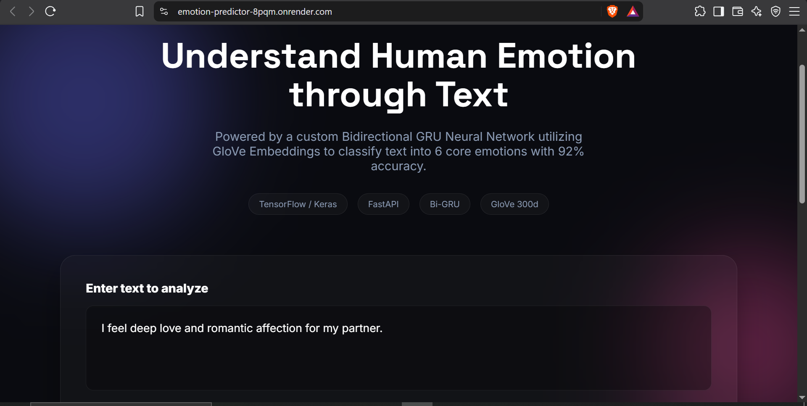
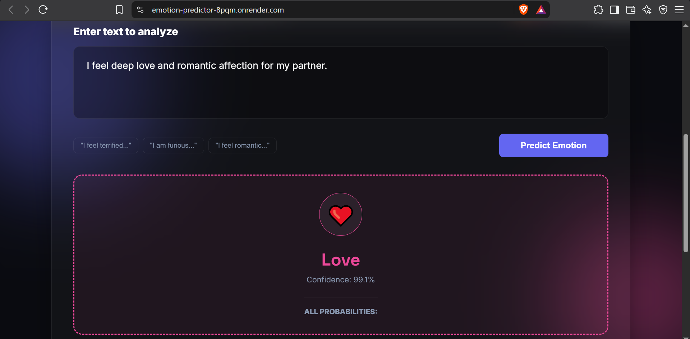

# 🧠 Emotion AI — Bidirectional GRU Text Classifier

A deep learning web application that classifies text into six core emotions: **sadness, joy, love, anger, fear, and surprise**. Built using a custom Bidirectional GRU neural network with pre-trained GloVe embeddings, served through a FastAPI backend, and deployed on Render.

🔗 **Live Demo:** [Emotion AI — Try It Here](https://emotion-predictor-8pqm.onrender.com/)

---

## 🖥️ Application Preview

### Emotion AI Application Preview

#### Text 



#### Emotion Prediction Result



</details>

---

## 📊 Model Architecture

This project experimented with multiple recurrent neural network architectures before selecting the final Bidirectional GRU model.

### Phase 1: Foundational Models

The following baseline models were explored:

- **Simple RNN** — A foundational recurrent neural network for sequential text data.
- **Standard LSTM** — A recurrent architecture designed to capture longer-term dependencies.
- **Standard GRU** — A gated recurrent architecture for learning sequential patterns.

### Phase 2: Bidirectional GRU — Final Model

The final model uses a Bidirectional GRU to process text in both forward and backward directions, allowing it to learn contextual information from both sides of a sequence.

**Reported validation accuracy:** Approximately 92%.

### Architecture Details

| Layer | Configuration |
|---|---|
| Embedding | Pre-trained 300-dimensional GloVe embeddings |
| Recurrent Layer 1 | Bidirectional GRU with 128 units, `return_sequences=True` |
| Regularization 1 | Dropout (0.5) |
| Recurrent Layer 2 | Bidirectional GRU with 64 units |
| Regularization 2 | Dropout (0.5) |
| Output Layer | Dense layer with 6 units and softmax activation |

The embedding layer uses `trainable=True`, allowing the pre-trained word embeddings to be fine-tuned during training.

---

## 🎯 Supported Emotions

The model predicts one of six emotion categories:

| Emotion | Description |
|---|---|
| 😊 Joy | Happiness, excitement, or positive feelings |
| ❤️ Love | Affection, care, or emotional attachment |
| 😢 Sadness | Sorrow, disappointment, or unhappiness |
| 😠 Anger | Frustration, irritation, or hostility |
| 😨 Fear | Worry, anxiety, or apprehension |
| 😲 Surprise | Unexpected events or sudden reactions |

The application also returns the predicted class confidence and probability scores for all six emotion categories.

---

## 📚 Dataset

The model was trained using the [dair-ai/emotion dataset on Hugging Face](https://huggingface.co/datasets/dair-ai/emotion).

The dataset contains text samples labeled with emotion categories and includes **16,000 training samples**.

The dataset is used to train a text classification model that learns patterns associated with the six target emotions.

---

## 🛠️ Tech Stack

**Backend**
- Python
- FastAPI
- Uvicorn

**Deep Learning**
- TensorFlow / Keras
- Bidirectional GRU
- GloVe word embeddings
- NumPy

**Frontend**
- HTML5
- CSS3
- Vanilla JavaScript

**Deployment and Version Control**
- Render
- GitHub

---

## 🏗️ Project Architecture

```text
                 User Input
                     |
                     v
             HTML / CSS / JavaScript
                     |
                     v
                FastAPI Backend
                     |
                     v
              Text Preprocessing
                     |
                     v
             Fitted Tokenizer (PKL)
                     |
                     v
           Bidirectional GRU Model
                     |
                     v
          Softmax Class Probabilities
                     |
                     v
             Predicted Emotion
                     |
                     v
              Frontend Result
```

---

## 📁 Project Structure

```text
Emotion-Predictor/
│
├── Artifacts/
│   ├── BiGRU_model.keras
│   └── tokenizer.pkl
│
├── static/
│   ├── index.html
│   ├── style.css
│   └── script.js
│
├── Imgages/
│   ├── text.png
│   └── emotion.png
│
├── main.py
├── requirements.txt
└── README.md
```

*The `screenshots/` folder is optional. Add the images you actually have and remove unused screenshot references.*

---

## ✨ Features

- 🧠 Deep learning-based text emotion classification
- 🔄 Bidirectional GRU architecture
- 📚 Pre-trained GloVe word embeddings
- 🎯 Six emotion categories
- 📈 Confidence score and class probability output
- ⚡ FastAPI-powered prediction endpoint
- 🌐 Interactive web interface
- 📱 Responsive frontend
- 📖 Interactive API documentation through FastAPI
- ☁️ Cloud deployment on Render

---

## ⚙️ Run Locally

Follow these steps to run the project on your machine.

### 1. Clone the repository

```bash
git clone https://github.com/Shahidd7/Emotion-Predictor.git
cd Emotion-Predictor
```

### 2. Create a virtual environment

```bash
python -m venv venv
```

### 3. Activate the environment

**Windows — PowerShell**

```powershell
.\venv\Scripts\Activate.ps1
```

**Windows — Command Prompt**

```bat
venv\Scripts\activate.bat
```

**macOS / Linux**

```bash
source venv/bin/activate
```

### 4. Install dependencies

```bash
pip install -r requirements.txt
```

Ensure the trained model and tokenizer files are available in the expected `Artifacts/` directory.

### 5. Start the FastAPI server

```bash
uvicorn main:app --reload
```

### 6. Open the application

- **Web Application:** http://127.0.0.1:8000/
- **API Documentation:** http://127.0.0.1:8000/docs
- **Health Check:** http://127.0.0.1:8000/health

---

## 🔌 API Endpoints

### `GET /`

Serves the main frontend interface.

### `GET /health`

Checks whether the application and model are available.

**Example response**

```json
{
  "status": "OK",
  "model_loaded": true
}
```

### `POST /predict`

Accepts input text and returns the predicted emotion, confidence score, and probability distribution.

**Example request**

```json
{
  "text": "I am furious that they cancelled the trip at the last minute."
}
```

**Example response**

```json
{
  "text": "I am furious that they cancelled the trip at the last minute.",
  "prediction_emotion": "anger",
  "confidence": 0.987,
  "all_probabilities": {
    "sadness": 0.001,
    "joy": 0.000,
    "love": 0.000,
    "anger": 0.987,
    "fear": 0.011,
    "surprise": 0.001
  }
}
```

*The response above is an illustrative example; actual predictions and probabilities depend on the input text and model output.*

---

## 📖 API Documentation

FastAPI automatically generates interactive API documentation.

Once the application is running locally, visit:

[http://127.0.0.1:8000/docs](http://127.0.0.1:8000/docs)

For the deployed application:

[Emotion AI — Live API Documentation](https://emotion-predictor-8pqm.onrender.com/docs)

---

## ☁️ Deployment

The application is deployed on **Render**.

**Build Command**

```bash
pip install -r requirements.txt
```

**Start Command**

```bash
uvicorn main:app --host 0.0.0.0 --port $PORT
```

Render provides the `PORT` environment variable used by the application.

**Live Application:** https://emotion-predictor-8pqm.onrender.com/

---

## ⚠️ Limitations

- Emotion classification is based on patterns learned from the training dataset.
- Sarcasm, slang, mixed emotions, and context-dependent language may be difficult to classify correctly.
- The predicted class and confidence score do not guarantee that the emotion has been identified correctly.
- The model is intended for text classification and educational demonstration, not psychological assessment or clinical diagnosis.

---

## 🔮 Future Improvements

- Add a confusion matrix and per-class precision, recall, and F1-score.
- Evaluate the model on unseen, real-world text.
- Improve handling of sarcasm, slang, and ambiguous language.
- Add a prediction history feature.
- Compare additional architectures and transformer-based models.
- Add automated API and frontend tests.
- Improve model explainability and error analysis.

---

## 👨‍💻 Author

**Shahid**

BCA — Artificial Intelligence, Machine Learning, Robotics & IoT

- **GitHub:** [Shahidd7](https://github.com/Shahidd7)

---

## 📄 License

This project is available under the MIT License, provided the repository includes the corresponding `LICENSE` file.

---

⭐ If you find this project interesting, feel free to explore the repository and try the live demo.
